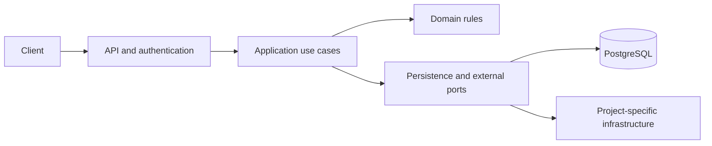

# ShelfFlow — Backend Developer Track

**Project 1 of 8 · Java 21 · Spring Boot 3.5.16 · Maven 3.9.9 · PostgreSQL**

> Start with [Getting Started](docs/GETTING_STARTED.md), then [Submission Rules](docs/SUBMISSION_RULES.md). The complete rules are below; milestone checklists point back here.

## 1. Overview

Build **ShelfFlow**, a backend for **library lending and overdue management**. You implement the application, data model, API and failure handling. The learning focus is: Spring IoC and auto-configuration, MVC REST, Bean Validation, JPA mappings, PostgreSQL, Flyway, transactions, pagination, test slices, Testcontainers, Actuator.

This is original learning material organized like the supplied `substream.zip`: numbered specification, stable business-rule IDs, M1–M3 shared milestones, D4–D7 developer milestones, an AQA guide and reflection. It is not connected to the SubStream/NIX grading bot. The reference project is [SubStream](https://github.com/Abd-Elrahman3/SubStream-Developer-Track); no completed solutions or proprietary bot are included.

## 2. How the Challenge Works

### 2.1 Milestones

Do projects in order. Start after you can write Java classes, collections, exceptions and basic JUnit tests.
Every milestone is required. Advanced requirements are part of completion, not optional stretch goals. M1–M3 establish the model, database and transactions; D4–D7 add contracts, difficult behavior, failure recovery and operation.

| Milestone | Goal | Branch | Guide |
| --- | --- | --- | --- |
| M1 | Domain and invariants | `feature/m1-domain` | [Shared](docs/SHARED_MILESTONES.md) |
| M2 | Database and persistence | `feature/m2-database` | [Shared](docs/SHARED_MILESTONES.md) |
| M3 | Transactional use cases | `feature/m3-transactions` | [Shared](docs/SHARED_MILESTONES.md) |
| D4 | API contracts and authorization | `feature/d4-api` | [Developer](docs/TRACK_DEVELOPER.md) |
| D5 | Advanced behavior and resource limits | `feature/d5-advanced` | [Developer](docs/TRACK_DEVELOPER.md) |
| D6 | Failure testing and recovery | `feature/d6-failures` | [Developer](docs/TRACK_DEVELOPER.md) |
| D7 | Operations and design defense | `feature/d7-operations` | [Developer](docs/TRACK_DEVELOPER.md) |

### 2.2 Levels

Bronze = M2; Silver = D4; Gold = D6; Platinum = D7 **with evidence**. Complete Platinum before progressing to the next project. A blocked feature should get a smaller reproducible experiment; do not mark it complete by removing its assertion.

### 2.3 How your work is evaluated

The starter compiles and runs only packaging tests by default. Behavioral examples and test exercises intentionally fail. `python3 scripts/check_progress.py --through M1` runs the cumulative milestone tests and checks evidence; advance through D7. The workflow runs this gate on milestone PR branches. A green starter build proves packaging only.

Automation is a guardrail, not proof of understanding. You own these repositories and can bypass local checks; keep the gates intact, review tests and explain tradeoffs aloud. There is no hidden evaluator and branch protection is not configured by these files.

## 3. Architecture



The API binds and validates transport input. The service establishes authorization and transaction boundaries. Domain objects enforce state rules. Persistence adapters map database data without leaking entities to API responses. Dependencies and clocks are constructor-injected. Keep network calls outside long database transactions and record uncertain outcomes explicitly.

See [Database Requirements](docs/DATABASE_REQUIREMENTS.md), [API Requirements](docs/API_REQUIREMENTS.md) and [Architecture Decisions](docs/ARCHITECTURE_DECISIONS.md) for this project's concrete boundaries.

### 3.1 How the classes relate

| Area | Responsibility |
| --- | --- |
| domain | Member, Book, BookCopy, Loan |
| service | Use cases, transaction boundary and principal-derived identity |
| repository / persistence | Ports, SQL/JPA/R2DBC mappings, constraints and query strategy |
| api | DTOs, controllers/resolvers, validation and error mapping |
| advanced | Required project-specific workers, policies and adapters |
| config | Dependency injection, Clock, security, typed configuration |

## 4. Domain Model

| Type | Fields / types | Invariant |
| --- | --- | --- |
| Member | UUID id; String email; String displayName; Instant joinedAt | Email trimmed/lowercase using Locale.ROOT; unique normalized email. |
| Book | UUID id; String isbn; String title; Set<String> authors | ISBN is exactly 13 ASCII digits in this exercise; title 1–200 trimmed characters. |
| BookCopy | UUID id; UUID bookId; CopyStatus status; long version | AVAILABLE or LOANED; only the lending service changes availability. |
| Loan | UUID id; UUID copyId; UUID memberId; LocalDate borrowedOn; LocalDate dueOn; LocalDate returnedOn | dueOn = borrowedOn + 14 days; returnedOn is nullable; no public setters. |

Fields are private. Do not add public state setters to bypass business methods. A rejected domain operation changes nothing. IDs are UUIDs unless explicitly stated otherwise. Identity equality uses persistent ID; value objects use their values. Store timestamps as UTC `Instant`; use `LocalDate` only for calendar-date rules. Nullability is explicit in database/API specs; unknown IDs are never treated as empty success. Use `ConflictException` for invalid state transitions and `IllegalArgumentException` for invalid domain values. Constructor signatures in starter examples are stable; you may add overloads, private fields and new classes as requirements grow.

The declared fields and constructors are scaffolding; constructors and business methods throw `UnsupportedOperationException("TODO: ...")`. Getters, enum values, Clock and the application entry point are provided. See [Starter Map](docs/STARTER_MAP.md).

## 5. Business Rules

Rule IDs are local to this repository. Each rule includes a concrete acceptance example. Full behavior, boundaries and failures matter; the examples are a starting test set.

### M1 — Domain and invariants

#### BR-101 — Validate members and books

Reject null/blank display names and titles; limits are 100 and 200 after trim. Email must contain one @, nonempty local part and a dot in the domain, and no whitespace. This deliberately small exercise rule is not full RFC email validation. Reject invalid values with IllegalArgumentException before any state change.

**Acceptance example:** "  Ada  " becomes "Ada"; " ADA@EXAMPLE.COM " becomes "ada@example.com"; 101-character name and 12-digit ISBN fail.

#### BR-102 — Use deterministic dates

All services receive Clock. Library dates use UTC. Loan due date is borrowedOn.plusDays(14); a loan is overdue only while unreturned and today.isAfter(dueOn). Domain methods accept dates explicitly.

**Acceptance example:** Borrow 2028-02-20 → due 2028-03-05. On March 5 it is not overdue; on March 6 it is.


### M2 — Database and persistence

#### BR-201 — Persist relationships and constraints

Use Flyway migrations and ddl-auto=validate. Store members, books, copies and loans with foreign keys, normalized-email uniqueness and a partial unique index on loans(copy_id) WHERE returned_on IS NULL. Do not use H2 as proof of PostgreSQL behavior.

**Acceptance example:** Two concurrent SQL inserts for an active loan on the same copy cannot both commit; orphan copy/member foreign keys fail.

#### BR-202 — Make queries bounded

GET books accepts page>=0, size 1..100, optional title substring, stable order title ASC,id ASC. Return a DTO page {items,page,size,totalElements}. Disable open-in-view and prevent lazy serialization.

**Acceptance example:** A page of 20 books does not issue 21 author queries. Capture SQL counts and EXPLAIN ANALYZE for a catalog of 10,000 books.


### M3 — Transactional use cases

#### BR-301 — Borrow atomically

A member may have at most five active loans. Borrow locks the member row first and then the copy row in one transaction. Unknown resources → NotFoundException; unavailable copy or limit reached → ConflictException. Persist loan and copy state together.

**Acceptance example:** With four active loans and two simultaneous borrow attempts, exactly one succeeds. A forced exception after loan insertion leaves no loan or copy change.

#### BR-302 — Return without duplicate effects

Returning an active loan sets returnedOn from the clock and makes the copy AVAILABLE in the same transaction. Repeating the return returns the original result with the original date. Returning before borrowedOn is invalid.

**Acceptance example:** Repeat tomorrow: the first returnedOn is unchanged; no extra notification record or availability increment appears.


### D4 — API contracts and authorization

#### BR-401 — Expose a stable REST contract

Implement all routes in docs/API_REQUIREMENTS.md. Use request/response DTOs and @Valid, 201 plus Location for creates, 200 for reads/return. Unknown IDs → 404; business conflicts → 409; invalid JSON/values → 400.

**Acceptance example:** Client can register a member, create a book/copy, borrow and return using api/examples.http.

#### BR-402 — Explain errors consistently

Use Spring ProblemDetail (RFC 9457) with type,title,status,detail,instance and code; validation errors add fieldErrors. Never expose stack traces, SQL or internal class names. Translate DB uniqueness races to 409.

**Acceptance example:** Duplicate normalized email → code MEMBER_EMAIL_EXISTS; missing member → MEMBER_NOT_FOUND; malformed UUID → 400.


### D5 — Advanced behavior and resource limits

#### BR-501 — Calculate overdue fines

A reporting service returns active overdue loans oldest due date first, id as tie breaker. Fine is 0.50 per full overdue calendar day, capped at 20.00, using BigDecimal scale 2; returned loans are excluded from this report.

**Acceptance example:** 1 day → 0.50; 40 and 41 days → 20.00; due today → absent.

#### BR-502 — Schedule reminders safely

Daily reminder creation stores a row unique on (loan_id,reminder_date). Two scheduler instances may race; only one row survives. A sender port is mocked for this project; failed sending leaves the row retryable.

**Acceptance example:** Run scheduler twice on the same date and simulate a sender failure: one reminder intent exists and the next run can retry it.


### D6 — Failure testing and recovery

#### BR-601 — Test the real boundaries

Write domain unit tests, @WebMvcTest for validation/errors, @DataJpaTest with PostgreSQL Testcontainers for constraints and a @SpringBootTest borrowing flow. Use a fixed Clock and deterministic barriers for races.

**Acceptance example:** A regression that removes the active-loan unique index or the five-loan guard makes a test fail.

#### BR-602 — Prove transaction behavior

Demonstrate rollback on RuntimeException, explain checked-exception rollback policy, and show why calling a @Transactional method on this does not apply proxy advice. Put the final boundary on a public service called through a Spring bean.

**Acceptance example:** Save an SQL snapshot before/after an injected failure and a short explanation of the effective isolation level.


### D7 — Operations and design defense

#### BR-701 — Operate the application

Expose liveness/readiness and metrics through Actuator without exposing environment/secrets. Add request correlation IDs and structured logs. Database loss makes readiness fail; liveness stays healthy.

**Acceptance example:** Stop PostgreSQL, capture readiness 503 and liveness 200, restore DB and show recovery.

#### BR-702 — Evolve and restore data

Add a V2 migration with a nullable audit field, backfill it, then enforce its constraint in a later migration. Test upgrading a V1 fixture. Back up and restore into a separate database and verify counts and active loans.

**Acceptance example:** Submit migration output, restore checks, query-plan evidence and the D7 reflection; a fresh empty database alone is insufficient.

## 6. Provided Infrastructure

Provided: pinned Maven build/wrapper, application entry point, UTC Clock bean, domain/API/repository/advanced stubs, Docker Compose, environment example, migration placeholder, API contract examples, packaging tests, intentionally red learning tests, CI and a cumulative gate. PostgreSQL migrations, business logic, authentication policy, transport handlers and behavior tests remain your work. Initial startup is not claimed until the required schema/configuration is implemented.

External providers must be mocked locally. No real payments, messages to customers or paid cloud accounts are needed. Install only the components required for the current milestone. See setup instructions for versions and ports.

## 7. Project Structure

```text
README.md                     full model and business rules
REFLECTION.md                 evidence of understanding
docs/GETTING_STARTED.md        setup and first milestone
docs/SHARED_MILESTONES.md       M1–M3 checklists
docs/TRACK_DEVELOPER.md         D4–D7 checklists
docs/TRACK_AQA.md               mandatory complementary testing track
docs/SUBMISSION_RULES.md        branches, commits, completion rules
docs/DATABASE_REQUIREMENTS.md  schema, constraints, indexes, migrations
docs/API_REQUIREMENTS.md       transport, status, auth and payload rules
docs/ACCEPTANCE_TESTS.md        failure and boundary test matrix
docs/ADVANCED_BACKEND_GATES.md  non-optional completion evidence
docs/LEARNING_PATH.md           eight-project progression
docs/primers/                  short concept guides and official references
docs/aqa/                      API test guidance
docs/evidence/                 fill after reproducing each milestone
pom.xml, mvnw, .mvn/            pinned build and wrapper
src/main/java/                unfinished application
src/test/java/                packaging checks and learning tests
src/main/resources/           application config and migration placeholder
api/                          contract and request examples
compose.yaml, .env.example     local infrastructure
scripts/check_progress.py     cumulative learning gate
.github/workflows/            starter build and milestone gate
```

## 8. What Good Code Looks Like Here

Use clear transaction boundaries, immutable DTOs, constructor injection and small use cases. Never depend on H2 to prove PostgreSQL locking/constraints. Never log credentials. Tests assert durable state and externally observable behavior, not only mocked call counts. Keep request/broker buffers bounded and retries limited. Explain every index, retry and trust boundary you introduce. Record actual measurements instead of assuming a technology is faster.

This curriculum covers a broad backend progression; it does not claim to exhaust every Spring module. [Learning Path](docs/LEARNING_PATH.md) maps the concepts and identifies follow-on subjects.

See [Implementation Labs and Contract Details](docs/IMPLEMENTATION_LABS.md) for concrete fixtures, payload semantics and boundary experiments. These are required, not optional extras.
